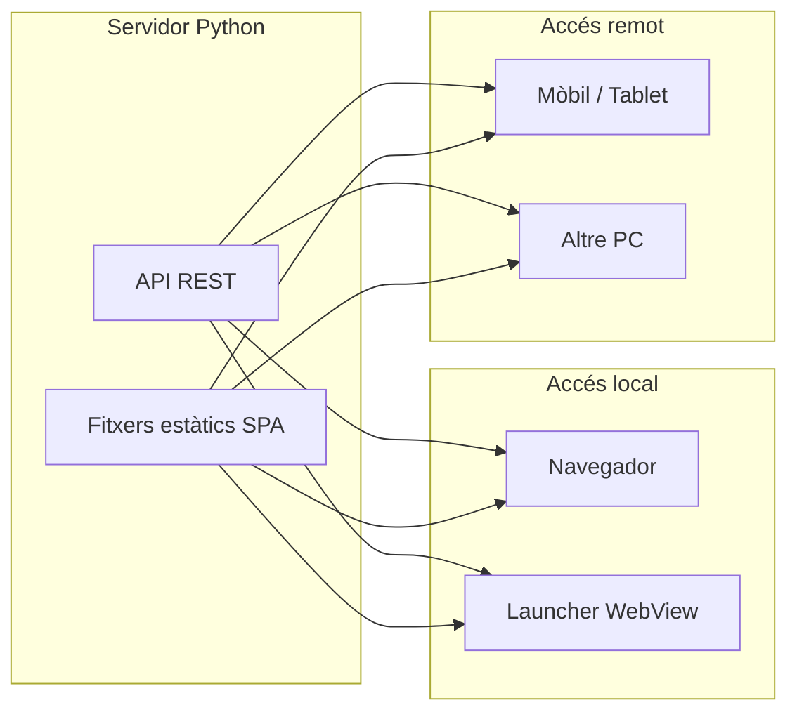

# Arquitectura Web UI — Transmutator V2

Aquest document descriu l’opció triada per a la interfície d’usuari: **API Python + frontend existent (Pipboy-Transfer) + launcher WebView opcional** amb accés local i remot.

## Opció triada

- **Backend:** Un sol servidor Python (FastAPI o equivalent) que:
  - Exposa l’API REST del pipeline (escaneig, iniciar/aturar, estat, progrés, config).
  - Sirveix els fitxers estàtics del build del frontend (React) a la mateixa instància.
- **Frontend:** La UI actual de Pipboy-Transfer (React/TypeScript), sense reimplementar; només canvis per connectar-la a l’API i afegir les peces que falten (config qBittorrent, persistència, canvi de categoria al acabar, navegació).
- **Accés local (opcional):** Un launcher Python (PyWebView o similar) que obre `http://127.0.0.1:PORT` en una finestra sense barra del navegador, per tenir sensació d’“aplicació de sobretaula”.
- **Accés remot:** El servidor s’enllaça a `0.0.0.0` (no només a localhost), de manera que des d’un altre dispositiu a la xarxa (mòbil, tablet, un altre PC) es pot obrir `http://<IP-del-host>:PORT` al navegador i usar la mateixa UI i API.

La TUI (Textual) **no es depreca**: es manté disponible i funcional, però des d’aquest punt el focus de desenvolupament és la Web UI; la TUI passa a ser secundària.

## Diagrama d’arquitectura

## Components

| Component | Descripció |
|----------|------------|
| **Servidor Python** | Process únic: API (escaneig, pipeline, config, progrés) + servir el build del client (SPA) a la arrel o a un path dedicat. Enllaç a `0.0.0.0:<port>` per permetre accés remot. |
| **Frontend (Pipboy-Transfer)** | Build de producció (React/Vite) desat en una carpeta que el servidor Python exposa com a estàtics. La UI es connecta a l’API del mateix host. |
| **Launcher WebView** | Script opcional (p. ex. `python -m src.web_launcher`) que inicia el servidor si cal i obre una finestra PyWebView amb la URL local. Només per a ús en el mateix PC. |
| **TUI** | `python -m src.app` o `python -m src.main --tui`. Mantinguda; no deprecada; prioritat inferior al desenvolupament. |

## Seguretat i xarxa

- **Xarxa local:** Enllaçar a `0.0.0.0` permet connexions des de qualsevol dispositiu a la LAN. No cal obrir cap port al router.
- **Internet:** Si més endavant es vol exposar fora de la xarxa local, cal afegir autenticació (p. ex. token, bàsic) i considerar HTTPS. Per ara l’àmbit és LAN.

## Resum

- Un sol backend (Python), una sola UI (la web).
- WebView opcional per a finestra “d’app” al PC host.
- Port exposat a la xarxa per connectar des d’un dispositiu remot via navegador.
- TUI secundària; no deprecada.

---
*Última actualització: Febrer 2026.*
